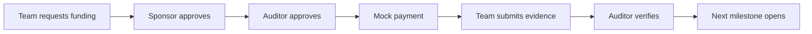
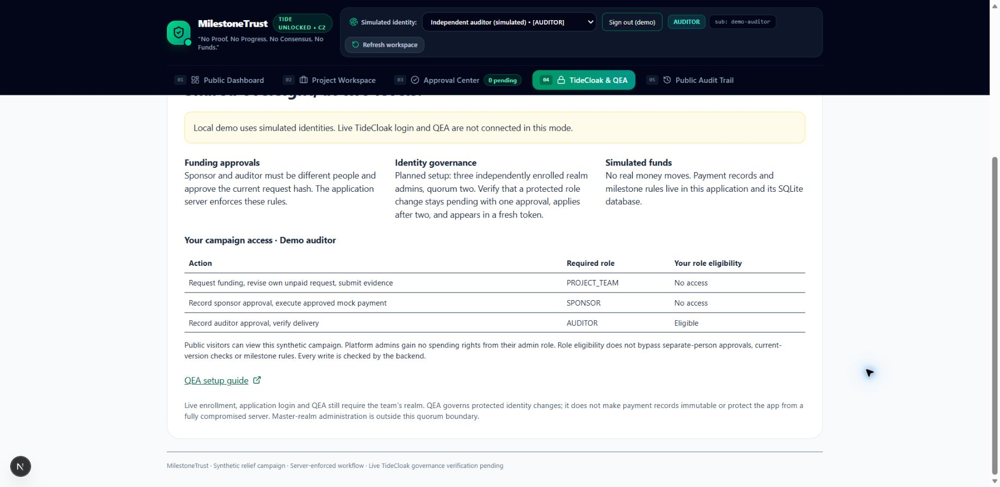

<div align="center">

# MilestoneTrust

**Relief funding. Progress with proof.**

Milestone-based community funding with independent spending approvals and a TideCloak identity integration.

[](https://github.com/TuanKhai1210/MilestonesTrust/actions/workflows/ci.yml)
[](https://github.com/TuanKhai1210/MilestonesTrust/actions/workflows/pages.yml)
[](LICENSE)

[**Explore the project →**](https://tuankhai1210.github.io/MilestonesTrust/) · [Run the application](docs/SETUP.md) · [TideCloak setup](docs/TIDECLOAK_SETUP.md)

RMIT Hackathon 2026 · Challenge 2: Tide UNLOCKED

</div>

## Project overview

**What are we building?** A relief-funding workspace that releases a community grant in stages, connecting each allocation to independent review and evidence of delivery.

**What trust constraint does it address?** Donors need progress without handing one operator unrestricted authority. The person requesting funds must not authorize their own spending or silently acquire the roles needed to do so.

**Who benefits?** Community teams, sponsors and independent auditors share a visible workflow. A synthetic clean-water campaign allocates 100 million VND across three milestones: 20M for a pilot, 30M for expansion and 50M for final installation.

**Why does TideCloak matter?** The application integrates TideCloak login and server-side token verification. A configured multi-admin realm can govern protected identity changes through QEA, while the application separately enforces spending approvals. Live realm login and QEA remain unverified.

**What does the prototype demonstrate?** Two distinct reviewers approve the same request version; edits clear approvals. A replay-safe mock payment precedes evidence review, and verified delivery opens the next milestone. Local simulated identities support a complete rehearsal. Campaign data and payments are synthetic.

## The workflow



- **Separate responsibilities:** team, sponsor and auditor have different server-enforced permissions.
- **Version-bound approvals:** changing a request invalidates previous approvals.
- **Controlled releases:** sponsor and auditor must have distinct subjects.
- **Sequential progress:** opening a milestone never automatically releases its allocation.

## Explore or run

| Experience | What it provides |
| --- | --- |
| [Public website](https://tuankhai1210.github.io/MilestonesTrust/) | Project overview and an interactive, illustrative walkthrough on GitHub Pages. |
| [Local application](docs/SETUP.md) | Working Next.js API, SQLite persistence and explicit simulated sign-in. |
| [TideCloak integration](docs/TIDECLOAK_SETUP.md) | Setup for real authentication and identity governance; live verification is pending. |

Requires **Node.js 24+** and npm:

```sh
git clone https://github.com/TuanKhai1210/MilestonesTrust.git
cd MilestonesTrust
npm ci
npm run demo
```

Open **http://localhost:3000**, choose a demo account and select **Simulate sign-in**. The [Vietnamese walkthrough](docs/CHAY_DEMO_VI.md) covers M1 → M2. For a separate clean rehearsal, stop the server and run `npm run demo:fresh`.

## Prototype preview



*Captured from the local application with simulated identities. The public website is a static showcase; it does not run authentication, the API or SQLite.*

## Engineering

**Next.js 16 · React 19 · TypeScript · Tailwind CSS 4 · Node.js SQLite · TideCloak SDK**

```sh
npm run check
npm run build
```

The 27 application tests cover authorization, campaign membership, independent reviewers, stale approvals, payment idempotency, session revocation, API validation and signed-token fixtures. See [verification evidence](docs/VERIFICATION.md) for scope and limitations.

## Current scope

The working demo uses synthetic identities, evidence and funds. No real bank transfer occurs. TideCloak integration code is present; live application login, QEA and complete DPoP verification still need validation. QEA governs protected identity changes, not mock payment records. The backend and SQLite remain trusted, and the application audit log is not immutable.

The two-minute submission recording is **not included yet**; see [demo requirements](demo/README.md). Repository publication and website deployment do not submit the challenge.

## Documentation

- [Setup, architecture and operational limits](docs/SETUP.md)
- [GitHub Pages deployment](docs/GITHUB_PAGES.md)
- [Live TideCloak setup](docs/TIDECLOAK_SETUP.md) and [integration plan](docs/TIDE_INTEGRATION_PLAN.md)
- [Demo walkthrough in Vietnamese](docs/CHAY_DEMO_VI.md) and [presentation script](docs/DEMO_SCRIPT.md)
- [Tide UNLOCKED challenge](https://tide.org/unlocked/#challenge)

## License

[MIT](LICENSE). Dependencies retain their own licenses.
