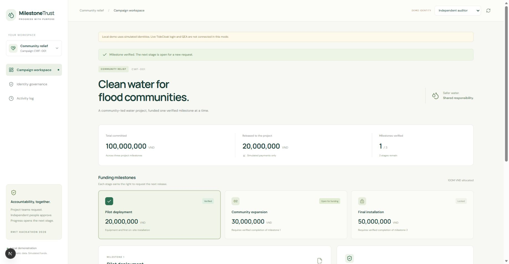
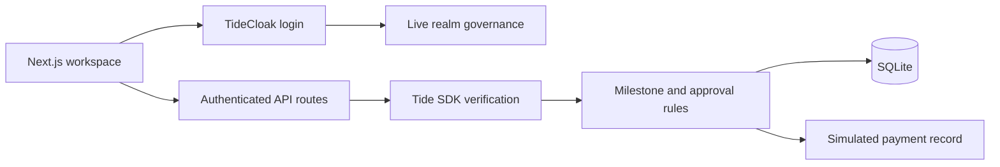

# MilestoneTrust

Milestone-based relief funding with independent spending approvals and TideCloak-governed identities.

## Project overview

**Vision & originality.** MilestoneTrust turns a community grant into a sequence of accountable releases. A relief team can get started without asking a donor to hand one administrator unrestricted control.

**Trust constraint insight.** Donors need timely delivery and oversight. A single project operator should not both request money and authorize it, or silently give themselves the roles needed to do so.

**Value & impact.** Our synthetic clean-water campaign allocates 100 million VND across three stages. A sponsor and an independent auditor review each request. Verified delivery opens the next stage, allowing useful work to continue with visible responsibility.

**Why TideCloak matters.** The app integrates TideCloak login and server-side access-token verification. A configured multi-admin Tide realm can govern protected role changes through QEA. Business approvals are separately enforced by the application. Local demo identities are explicitly simulated and are not evidence of live TideCloak protection.

**Prototype & storytelling.** The workspace demonstrates two-person approvals bound to a request version, replay-safe simulated payments, evidence verification and milestone sequencing. The governance view links to the real Tide Console for a pending-then-approved QEA demonstration after realm setup. All campaign records and funds are synthetic. No real transfer occurs.

## Workspace preview



This screenshot uses simulated local identities. It is not evidence of live Tide authentication or QEA.

## Run the local demonstration

Requires **Node.js 24+** and npm. The database uses Node's built-in SQLite. No Docker or Tide account is required for the explicitly simulated local mode.

```sh
npm ci
npm run demo
```

Open **http://localhost:3000**. Select Project team, Sponsor, Independent auditor or Platform admin in the top bar. Demo mode binds to loopback and is refused in production. It must not be presented as real authentication or QEA.

1. Team: request milestone 1 funding.
2. Sponsor: approve. Release remains locked.
3. Auditor: approve the same request.
4. Sponsor: release simulated funds.
5. Team: submit a short synthetic delivery note.
6. Auditor: verify delivery. Milestone 2 opens, without an automatic payment.

## Connect live TideCloak

See **[the setup guide](docs/TIDECLOAK_SETUP.md)**. Export your public client adapter to `config/tidecloak.json`, set the roles in `config/README.md`, then:

```sh
npm run dev
```

Default authentication is TideCloak. Missing configuration never enables demo identities. Tokens are verified with the official `@tidecloak/nextjs/server` SDK plus issuer/client checks. Configuration, databases, credentials and local environment files are gitignored. Use a public OIDC client without a secret.

For production-shaped local testing, use `npm run build` followed by `npm start` with a configured realm. `AUTH_MODE=demo` is rejected by the production server.

## Verification

```sh
npm run check
npm run build
npm run doctor
```

The tests cover role and membership checks, self-approval, duplicate subjects, version changes, stale approvals, milestone sequencing, payment idempotency, malformed amounts and fail-closed authentication modes. They use synthetic actors, not a live Tide realm.

## Architecture and limits



- This MVP has one campaign. `mt_member` grants membership in that campaign; extend the membership model before adding campaigns.
- Sponsor and auditor approvals must come from distinct token subjects. A request creator cannot approve their own request. A single human's control of multiple external accounts is outside this prototype's verification.
- Request versions bind amount, recipient, purpose, milestone and policy version. This consistency hash is not a cryptographic approval signature or protection against a fully compromised database/server.
- QEA governs protected identity changes. It does **not** cryptographically authorize these mock payments. The backend and SQLite remain trusted for the spending workflow.
- The `master` realm is outside QEA. Do not claim immunity against every administrator or infrastructure compromise.
- Evidence is reviewed by an auditor; the app does not establish that an invoice or physical delivery is genuine.
- The audit log is an application log, not an immutable ledger. No Forseti signing, E2EE vault, real bank integration or blockchain is implemented.
- Live Tide login/QEA requires enrollment and realm setup. Until verified, do not describe the prototype as competition-ready or claim the live integration has passed.

## Demo and submission

See **[the two-minute script](docs/DEMO_SCRIPT.md)** and **[team work split](docs/TEAM.md)**. Record an actual `.mp4` under 100 MB and put it in `demo/demo.mp4`. The recording is not included yet. The README overview above is under 300 words; setup documentation is separate.

Challenge 2 asks for a public repository containing code and the recording, submitted through the form on [Tide UNLOCKED](https://tide.org/unlocked/#submit). Creating this repository does not submit the challenge.

## Sources

- [TideCloak Next.js integration](https://docs.tide.org/Languages/NextJS/tidecloak-nextjs-how-to-guide)
- [QEA setup](https://docs.tide.org/Admin/SetupIGA) and [governance model](https://docs.tide.org/Core-Concepts/iga-workflow)
- [Tide UNLOCKED challenge and judging](https://tide.org/unlocked/#challenge)

## License

MIT. Dependencies retain their own licenses.
