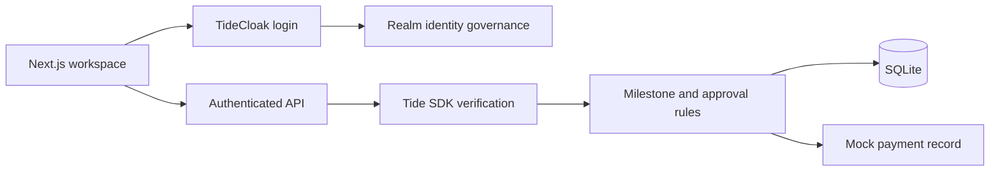

# Run MilestoneTrust

Requires **Node.js 24+** and npm. SQLite uses Node's built-in module. The operational application requires a Node.js server; GitHub Pages hosts a separate public showcase.

## Local demonstration

```sh
npm ci
npm run demo
```

Open **http://localhost:3000**. Select a demo account, then **Simulate sign-in**. Sign out before switching accounts. Persona selection alone grants no session: the server issues an opaque, revocable session with server-owned roles and a 30-minute expiry. Reloading clears its in-memory browser session.

For a fresh rehearsal, stop the app and run `npm run demo:fresh`. This creates a new database and retains previous runs. Refreshing the workspace only reloads server data. The [Vietnamese walkthrough](CHAY_DEMO_VI.md) gives exact buttons and negative cases.

1. Team creates the M1 request.
2. Sponsor approves. Payment remains locked at 1/2 approvals.
3. Auditor approves the same request version.
4. Sponsor records the mock payment.
5. Team submits synthetic delivery evidence.
6. Auditor verifies it. M2 opens without an automatic payment.

Demo authentication binds to loopback and is rejected in production. It is not real TideCloak authentication or QEA.

## Live TideCloak

Follow [TIDECLOAK_SETUP.md](TIDECLOAK_SETUP.md). Export the public client adapter into the gitignored `config/tidecloak.json`; configure roles using [config/README.md](../config/README.md).

```sh
npm run dev
```

TideCloak is the default authentication mode. Missing configuration never enables demo identities. The official `@tidecloak/nextjs/server` SDK verifies tokens, with additional issuer and client checks. Use a public OIDC client without a secret; keep credentials and management tokens out of browser configuration and Git.

For a production build with a configured realm:

```sh
npm run build
npm start
```

The supplied start command binds to loopback. Hosting requires Node.js 24, persistent writable SQLite storage, appropriate host/reverse-proxy configuration and correct TideCloak origins and redirect URIs. GitHub Pages cannot provide these services.

## Validation

```sh
npm run check
npm run build
npm run doctor
```

`check` runs TypeScript and application tests. Signed ES256 fixtures use generated local keys, not live realm tokens. `doctor` checks prerequisites; it does not prove enrollment or QEA. See [verification](VERIFICATION.md) and the [integration plan](TIDE_INTEGRATION_PLAN.md).

## Architecture



The frontend reads `/api/state`, writes through `/api/actions` and uses `/api/demo/session` only in local demo mode. Failed requests remain failures, without a local-success fallback.

## Operational limits

- One campaign: `mt_member` means membership in that campaign. Extend membership before adding campaigns.
- Sponsor and auditor require distinct token subjects. A creator cannot approve their own request. One human controlling several external accounts is outside these checks.
- Request versions bind amount, recipient, purpose, milestone and policy version. The hash is not a cryptographic signature or a defense against a compromised server/database.
- QEA governs protected identity changes; it does not authorize mock payments. The `master` realm is outside QEA.
- Evidence requires auditor review. The app cannot establish that invoices or physical delivery are genuine.
- The application log is not immutable. No real bank integration, Forseti signing, E2EE vault or blockchain is implemented.
- Live realm login, QEA and complete DPoP verification remain pending.

## Repository map

| Path | Purpose |
| --- | --- |
| `src/app/` | Workspace, authentication redirect and API routes |
| `src/lib/` | Authorization, sessions, persistence and domain rules |
| `src/components/` | Five-tab application interface |
| `tests/` | Application and cryptographic fixture tests |
| `docs/` | Guides, screenshots and static website |
| `scripts/build-pages.mjs` | Packages public assets into `out-pages/` |
| `.github/workflows/` | Application CI and Pages deployment |

Adapter files, credentials, local environment files and databases are gitignored.
